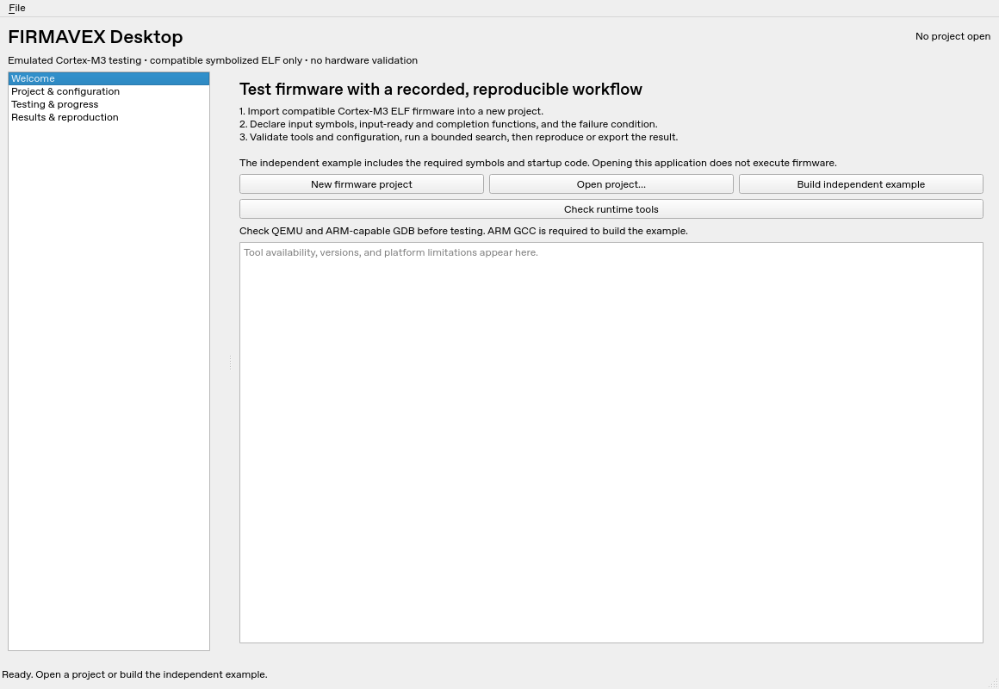
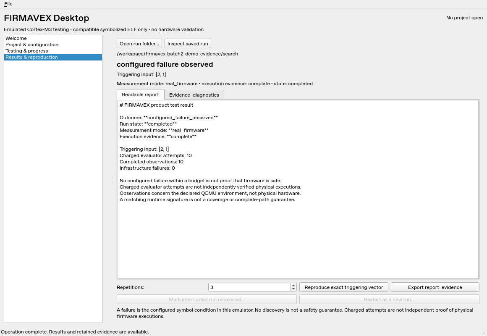

> Current distribution and native runtime qualification: [Batch 3](batch3.md).
> This document describes the Batch 2 UI workflow; its earlier platform limitations
> are historical where superseded by the Batch 3 validation record.

# FIRMAVEX Desktop — Batch 2

Batch 2 is a functional PySide6 desktop workflow around the Batch 1 engine, not a
standalone native installer. No firmware runs on startup, project import, tool
checking, result inspection, or export. Every firmware execution uses the existing
supervised worker and evaluator accounting. Frozen research data remain separate.

## Install and launch on Ubuntu/WSL

Use Ubuntu 24.04+ or an existing Python 3.11/3.12 installation. WSL needs WSLg for
interactive windows; an SSH/headless terminal alone is insufficient. Keep projects,
virtual environments, and outputs on the Linux filesystem under your home folder.

The following creates a fresh checkout and environment; it does not modify an
existing FIRMAVEX repository, research archive, backup, or analysis directory:

```bash
bash <<'FIRMAVEX_DESKTOP'
set -euo pipefail
sudo apt update
sudo apt install --no-install-recommends -y git python3 python3-venv \
  gcc-arm-none-eabi qemu-system-arm gdb-multiarch \
  libegl1 libgl1 libopengl0 libxkbcommon-x11-0 libxcb-cursor0
FIRMAVEX_DESKTOP_ROOT=$(mktemp -d "$HOME/firmavex-desktop-batch2-XXXXXXXX")
git clone --branch product/desktop-batch2 --single-branch \
  https://github.com/mtalhak003/FIRMAVEX.git "$FIRMAVEX_DESKTOP_ROOT/source"
cd "$FIRMAVEX_DESKTOP_ROOT/source"
python3 -c 'import sys; assert sys.version_info >= (3,11), "Python 3.11 or newer is required"'
python3 -m venv "$FIRMAVEX_DESKTOP_ROOT/venv"
source "$FIRMAVEX_DESKTOP_ROOT/venv/bin/activate"
python -m pip install '.[dev,desktop,gui-test]'
QT_QPA_PLATFORM=offscreen python -m pytest -q tests/product tests/desktop
QT_QPA_PLATFORM=offscreen firmavex-desktop --smoke-test
printf '\nInstalled environment: %s\nLaunch later with:\nsource "%s/venv/bin/activate"\nfirmavex-desktop\n' \
  "$FIRMAVEX_DESKTOP_ROOT" "$FIRMAVEX_DESKTOP_ROOT"
firmavex-desktop
FIRMAVEX_DESKTOP
```

The validation command includes bounded independent firmware tests, not the
controlled research campaign. Only the final command opens an interactive window.
If WSLg is unavailable, validation can run offscreen but interactive use remains
blocked until a graphical session is available. ARM-capable GDB is discovered
as `arm-none-eabi-gdb` or `gdb-multiarch`; the product does not require a symlink.

For a GUI-only installation, use `python -m pip install '.[desktop]'`.
For a CLI-only installation, use `python -m pip install .`.
Both `firmavex-desktop` and `firmavex desktop` launch the same application.
`firmavex-desktop --project /path/to/project` opens a saved project without running
firmware. `--smoke-test` starts/closes the widgets without tool or guest dispatch.

## Guided first demonstration

1. On Welcome, select **Check runtime tools**. Review executable versions and
   limitations. Tool presence is not proof of firmware compatibility. ARM GCC is
   additionally required for the example build.
2. Select **Build independent example**. The compiler runs in the worker; the
   imported project opens only after cleanup. No guest firmware runs during build.
3. Review Project & configuration. The example uses two ordered uint32 inputs
   `product_inputs[0]`, `product_inputs[1]`, inclusive domain `0..3`, readiness
   `product_input_ready`, completion `product_complete`, and failure condition
   `product_failure == 1`. Its enumerative budget is 16, without a seed.
4. Select **Validate firmware & tools**, then **Run bounded test**. Progress shows
   charged attempts, exact vectors, observations, bounded signatures, and events.
   The ordinary public `safe` status is displayed as **Condition not observed**;
   it is not a safety judgment. Only one operation can run at a time.
5. The defined example trigger is `[2, 1]`, reached at charged attempt 10. In
   Results, inspect the readable report and retained evidence.
6. Select three repetitions and **Reproduce exact triggering vector**. Reproduction
   owns a separate budget/result directory and uses the original image/tool
   identities. Infrastructure failure makes reproduction indeterminate.
7. **Export report & evidence** creates a new export directory. The original run
   remains unchanged. Exports are private administrative data until reviewed.

Linux offscreen screenshots, captured from real widgets:





The result screenshot displays a copied, verified archive from an actual desktop
integration test. Screenshot capture performed archive inspection only, without
rerunning firmware or changing that archive. It is not synthetic GUI evidence.

## Import your compatible firmware

Choose a regular ELF file and a fresh project folder. Set the ordered input
bindings, input-ready/completion function symbols, uint32 domain, failure symbol
and equality value. Choose enumerative, random, or feedback-guided search. Seeded
strategies require an explicit integer seed. Configure budget, timeouts, signature
collection, and optional absolute tool overrides. Guided search requires signatures.

Supported firmware is ELF32 little-endian ARMv7-M/Cortex-M3, with reset vectors,
DWARF uint32 bindings, and QEMU `mps2-an385`-compatible memory/peripherals. The
profile uses flash `0x00000000..0x003fffff` and RAM `0x20000000..0x203fffff`.
Typed scalar/one-dimensional array-element inputs share inclusive uint32 bounds.
The ready function must occur after initialization and before input consumption;
the completion function must precede failure observation. These functions must
be distinct. Numeric fields support decimal and `0x` hexadecimal, including the
entire uint32 range.

Static validation cannot establish peripheral compatibility. BIN, stripped ELF,
other CPU/board profiles, arbitrary debugger expressions, hardware probes,
interactive peripheral input, and automatic vulnerability judgments are unsupported.

Project import copies firmware unchanged. Projects have an identity marker,
immutable firmware, append-only configuration versions, atomic active-config
replacement, and native writer ownership. Changed imported images are rejected.
Each command dispatches an immutable saved configuration snapshot, so another
window cannot change the admitted settings by editing the active project file.
Run results import their own image/configuration and remain independent of later
project edits. Observed consistency checks are not an atomic filesystem snapshot.

## Progress, cancellation, recovery, and evidence

The GUI uses queued signals from a QThread around the existing supervised worker.
Import, project verification, and configuration saves also run off the GUI thread.
Fields/actions that could start a conflicting operation are disabled while busy.
Navigation, rendering, and cancellation remain responsive. No QThread is forcibly
terminated. Closing an active window requests cancellation and waits asynchronously
for worker cleanup; a project filesystem operation is allowed to finish first.

The table retains the latest 500 observations and the log 1,000 blocks. Full
registered evidence remains in the archive. Diagnostic transport previews are
explicitly bounded/labeled; scientific counts and vectors are never truncated.
Infrastructure/observation failure stops dispatch and cannot become a safe result.

Use **Open run folder** to inspect results without executing firmware. Unfinished
archives have no assumed completion. **Mark interrupted run recovered** requires
explicit confirmation and preserves unknown accounting. **Restart as a new run**
requires explicit authorization and repeats a fresh search in a new directory;
partial strategy-state continuation is not implemented. Completed jobs are not
rerun automatically. Missing receipts remain explicit, with execution verification
failed. A pre-terminal result artifact is not promoted to a completed database run.

Counts are charged evaluator attempts and completed observations, not independently
verified physical executions. Emulator receipts do not establish hardware behavior,
security guarantees, coverage, or complete-path identity. Review absolute paths,
input values, firmware ownership, supplied settings, and diagnostics before sharing
reports. No finding repairs or changes the Step 19 research evidence gap.

## Platform readiness and CI

| Area | Linux | Windows | macOS |
| --- | --- | --- | --- |
| Desktop | Offscreen widgets and real workflow tested locally | Native offscreen Qt/installation CI passed (3.11/3.12) | Native offscreen Qt/installation CI passed (3.11/3.12) |
| Firmware execution | Bounded actual ARM/QEMU/GDB checks pass locally | Explicitly blocked pending native ARM qualification | Native ARM execution unverified |
| Process ownership | POSIX worker group/direct-child cleanup tested | Job Object native host-process tests passed in CI | POSIX abstraction; native host tests passed in CI |
| Installer/runtime pack | Python wheel/source installation | No signed installer/runtime pack | No notarized installer/runtime pack |

The existing Windows firmware gate is deliberately retained. Passing a host Python
Job Object test or opening a Qt window does not prove ARM firmware execution.
Selected executable/wrapper identities do not inventory every shared library.
Power-loss durability and network-filesystem behavior are not qualified.

Batch 1 Actions run **38166140242** was observed as failed on the public GitHub
page. Detailed logs required sign-in and REST API access returned Forbidden.
The old Ubuntu Python 3.11 unit selection passed when reproduced in a fresh local
3.11 environment; that does not identify or erase its historical CI failure.
Batch 2 adds explicit build-backend development dependencies, desktop/package
checks, Windows host ownership tests, and public JUnit-derived job summaries.
Batch 2 run [38255127322](https://github.com/mtalhak003/FIRMAVEX/actions/runs/38255127322)
passed all six native OS/Python matrix jobs and the Ubuntu real-firmware job
for code commit `84c0561f7798ffc45096a9df6da40cd6129dd3e8`. These native host/Qt
checks do not qualify Windows/macOS ARM execution, interactive usability, or installers.

## Next batch

Prioritize native Windows/macOS ARM runtime qualification, any remaining CI
failures, application usability testing on WSLg/native displays, and signed
installers with license-compliant runtime dependency management. Retain unsupported
platform gates until qualified. Add project/result history navigation, improved
report presentation, and crash/cancellation soak tests before a v1.0 claim.
